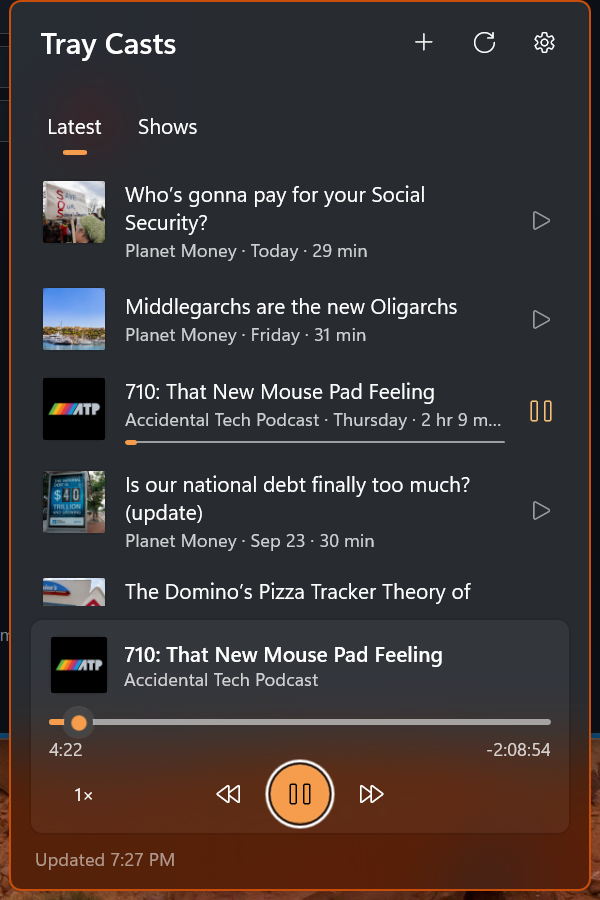

# Tray Casts



A podcast player that lives in the Windows notification area. Click the tray icon to pick an episode, then click away. It keeps playing.

Tray Casts is a WinUI 3 app with no main window. The tray icon opens a small flyout next to it with your latest episodes, your shows, and the player. Playback carries on after the flyout closes, and you control it from the tray menu, your keyboard's media keys, or the Windows media overlay.

## Features

- **Latest:** the 50 newest episodes across every show you follow, newest first. Each row shows its show, date, length, and a progress bar if you've started it.
- **Shows:** the shows you follow, most recently active first. Open one to see its 100 newest episodes, or to unfollow it.
- **Add a podcast:** search by name in the Apple Podcasts directory, or paste a feed address (`https://`, `feed://`, or a bare `feeds.example.com/show`).
- **Player:** seek bar, skip back and forward (15 s and 30 s by default), and a speed button that cycles through 1×, 1.25×, 1.5×, 1.75×, 2×, and 0.75×.
- **Resume:** every episode picks up where you left off, about two seconds back so you catch the end of the sentence. An episode within 30 seconds of its end (or the last 10% of a short one) counts as played.
- **Played state:** right-click an episode (or press Shift+F10) to mark it played or unplayed, or to go to its show.
- **Media keys and overlay:** play/pause works as usual. Next and previous skip forward and back, and the Windows media overlay shows the episode, its show, and its artwork.
- **Tray menu:** right-click the icon for Pause/Resume, Back, Forward, Open, Settings, and Exit. The tooltip shows what's playing.
- **Settings** (inside the flyout): Start with Windows, and the skip-back and skip-forward intervals.
- **Keyboard:** Escape goes back from a show, search, or settings, then hides the flyout. Alt+Left and the mouse back button also go back.
- **Theme-aware:** the tray icon swaps between a white and a dark glyph to match the taskbar, and the flyout uses the same acrylic as Windows' own flyouts.
- **Single instance:** launching the app again opens the running instance's flyout.

## Install

Build from source (below) for now. Releases will be signed x64 and ARM64 MSIX packages on the GitHub releases page. Sideloading one means installing its signing certificate first.

Requirements: Windows 10 1809 (build 17763) or later, x64 or ARM64.

## Setup

None. There are no accounts or API keys. Search uses the public iTunes Search API, and feeds are plain RSS.

## Privacy and footprint

- **Network:** feeds are checked only while the flyout is open: when it opens, if the last check was more than 15 minutes ago, then every 30 minutes while it stays open. Requests are conditional (`If-None-Match` / `If-Modified-Since`), so an unchanged feed costs one tiny response. Search sends only the words you type, after a short pause. Audio streams from the episode's own host while it plays. Nothing else leaves your PC: no analytics, no accounts.
- **Storage:** your shows (`library.json`) and listening progress (`progress.json`) are JSON files in the app's local data folder. Settings and the episode in the player are in the app's local settings. No secrets are stored, because there aren't any.
- **Memory:** after the flyout has been hidden for a minute it closes for real, and its lists are dropped from memory. With an episode paused and no window open, the app sits at about 14 MB working set. A paused player is released after 15 minutes, with its position saved, so a forgotten episode doesn't hold the media pipeline.

## Build from source

Prerequisites: the [.NET 10 SDK](https://dotnet.microsoft.com/download), the winapp CLI (`winget install Microsoft.WinAppCli`), and Developer Mode on (Settings > System > For developers) so the app can be registered with package identity.

```powershell
cd TrayCasts
winapp run              # build, register, and launch; the first run opens the flyout
winapp run --clean      # start over with no shows (first-run state)
winapp run -c Release   # trimmed ReadyToRun build, as shipped
```

Tests cover the RSS parser, dates and durations, search parsing, feed-address detection, the playback rules, formatting, and storage:

```powershell
dotnet test TrayCasts.Tests
```

`build-msix-for-gh.ps1` builds signed x64 and ARM64 MSIX packages and drafts a GitHub release.

## Project layout

| Path | What it holds |
|---|---|
| `TrayCasts/App.xaml.cs` | Tray icon, the tray menu with playback controls, single instance, the only exit path |
| `TrayCasts/Views/TrayFlyoutWindow` | The borderless popup: placement, light dismiss, animation, settings-page swap, back navigation |
| `TrayCasts/Views/FlyoutPage` | Latest, Shows, a show's episodes, search, and the now-playing card |
| `TrayCasts/Views/SettingsPage` | Start with Windows and skip intervals, shown inside the flyout |
| `TrayCasts/Views/ListItems.cs` | Row view models and the per-flyout artwork cache |
| `TrayCasts/Services/PlaybackService.cs` | The `MediaPlayer`, media keys and overlay, progress saving, and releasing the player when idle |
| `TrayCasts/Services/LibraryService.cs` | Following, unfollowing, and refreshing shows; loading and saving the library and progress |
| `TrayCasts/Services/ForegroundPoller.cs` | Refreshes only while the flyout is visible, with backoff |
| `TrayCasts.Core/Feeds` | RSS parser (iTunes and Media RSS extensions), lenient date and duration parsing, the conditional-GET feed client, feed-address detection |
| `TrayCasts.Core/Search` | iTunes Search API client and parser |
| `TrayCasts.Core/Storage` | Atomic JSON files, merging a refresh, and the latest-episodes list |
| `TrayCasts.Core/Playback` | Resume, finished, speed, and skip rules |
| `TrayCasts.Core/Formatting` | "Yesterday", "1 hr 5 min", "12 min left", and the tray tooltip |
| `TrayCasts.Tests` | MSTest tests for everything in Core |

`TrayCasts.Core` has no Windows dependencies, so its tests run on plain `net10.0`.

## How it works

**Playing with no window.** Tray apps here don't work while hidden. Playback is the deliberate exception: you start it, and the tray icon, menu, and media keys are its UI. `PlaybackService` owns the one `MediaPlayer` for the app's lifetime and connects its command manager to the media keys and overlay. Player events arrive on background threads. Each one is marshaled to the UI thread and dropped if its player has since been released, because touching a released player's media controls crashes the process natively.

**Progress.** The position is saved every 15 seconds while playing, on pause, when switching episodes, and on exit. Progress lives apart from the feed cache, so a refresh that rewrites a show's episodes never loses it.

**Feeds.** Feeds are untrusted XML: DTDs are ignored and nothing external is resolved. Responses are capped at 32 MB, and only http(s) enclosures are kept. Dates come in every flavor of RFC 822 (named zones, missing seconds, two-digit years, "Sept."), and `FeedValues` reads them all, falling back to UTC rather than dropping a date. Up to four feeds are fetched at once, parsing happens off the UI thread, and results merge back on it.

## License

MIT, see [LICENSE](LICENSE).
